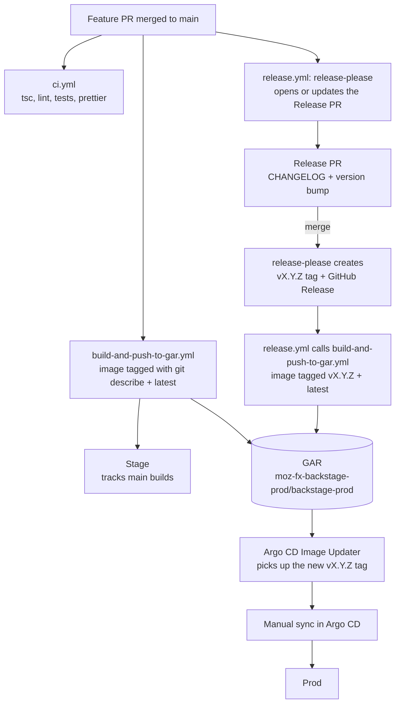
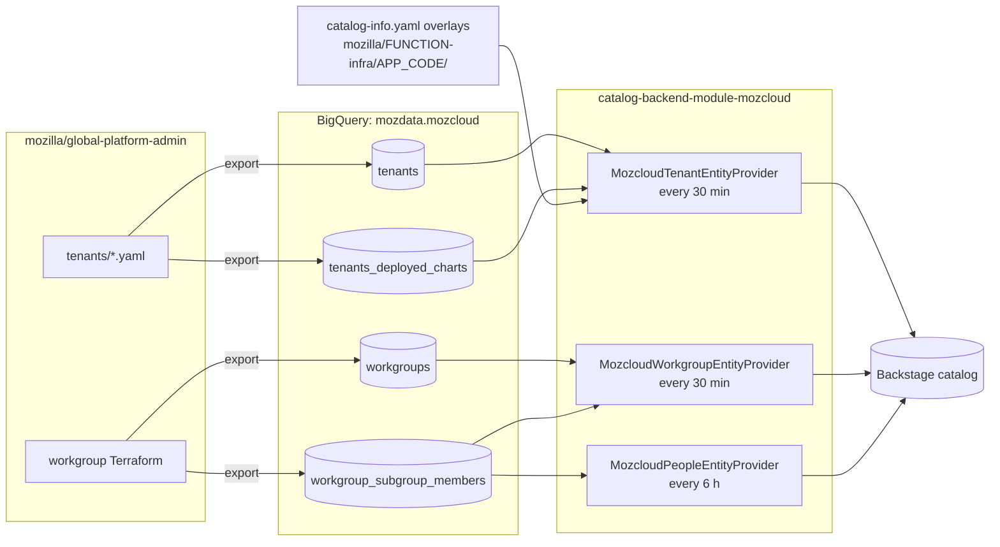
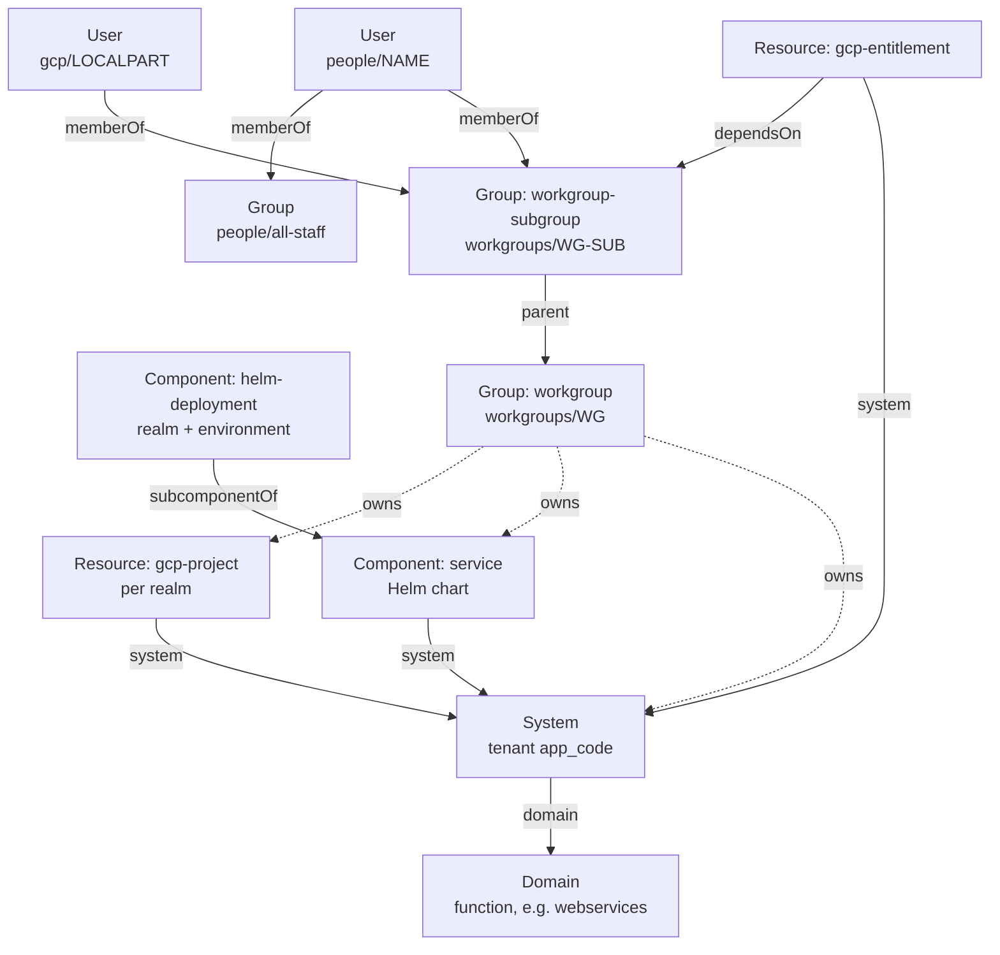
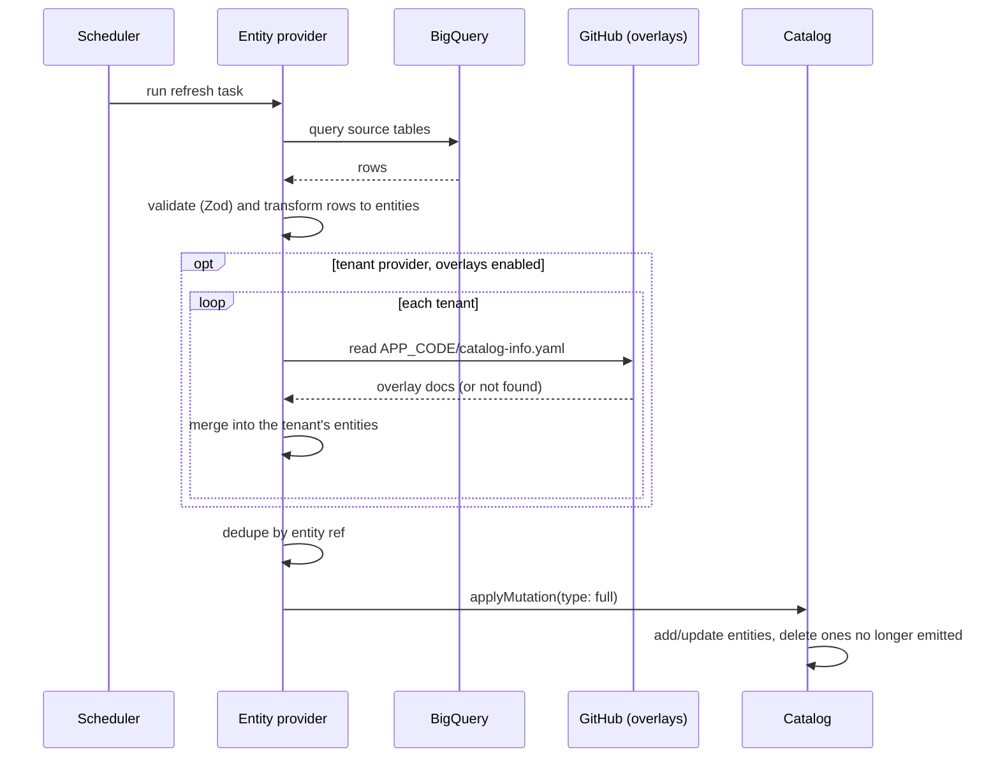

# Mozilla [Backstage](https://backstage.io) App

Mozilla's internal developer portal. A Yarn 4 monorepo with a frontend app
(`packages/app`), a backend (`packages/backend`) and custom plugins
(`plugins/`).

- [Developing](#developing)
- [Release process](#release-process)
- [How the catalog is hydrated](#how-the-catalog-is-hydrated)

## Developing

### Dependencies

Run postgres & redis backends with docker-compose:

```sh
docker compose up
```

> `docker-compose.yaml` defines volumes for postgres & redis to persist data for as long as the compose stack isn't destroyed.

Set environment variables for postgres (or use `.env` file):

```sh
cp .env.sample .env

export POSTGRES_HOST=localhost
export POSTGRES_PORT=5432
export POSTGRES_USER=postgres
export POSTGRES_PASSWORD=secret
```

To start the app, run:

```sh
nvm use
yarn install
yarn start
```

If using a `.env` file for the environment variables:

```sh
npm install -g dotenv-cli (if you don't have dotenv installed already)
dotenv -- yarn dev
```

### Checks

CI (`.github/workflows/ci.yml`) runs these on every PR; run them locally
before pushing:

```sh
yarn tsc
yarn lint:all
yarn test:all
yarn prettier:check
```

## Release process

Releases are automated with
[release-please](https://github.com/googleapis/release-please). Version
bumps come from [Conventional Commit](https://www.conventionalcommits.org)
messages, so PR titles and commit messages should use a prefix such as
`feat:`, `fix:`, `docs:` or `chore:`.



### Steps

1. **Merge PRs to `main`.** Each push to `main` builds an image tagged with
   `git describe --tags` (e.g. `v0.1.5-3-gabc1234`) and `latest`. Stage
   deploys these `main` builds.
2. **release-please keeps a Release PR open.** On every push to `main`,
   `release.yml` opens or updates a PR that bumps the version in
   `package.json` and `.release-please-manifest.json` and updates
   `CHANGELOG.md`.
3. **Merge the Release PR to cut a release.** The next `release.yml` run
   creates the `vX.Y.Z` tag and GitHub Release, then calls
   `build-and-push-to-gar.yml` to build and push an image tagged `vX.Y.Z`.
4. **Deploy to prod.** The Argo CD Image Updater detects the new `vX.Y.Z`
   image, then someone syncs the prod app in Argo CD by hand.

### Version bumps

The project is pre-1.0 and `release-please-config.json` sets
`bump-minor-pre-major` and `bump-patch-for-minor-pre-major`, so:

| Commit type                           | Bump                      |
| ------------------------------------- | ------------------------- |
| `feat!:` / `BREAKING CHANGE:`         | minor (`0.1.5` → `0.2.0`) |
| `feat:`                               | patch (`0.1.5` → `0.1.6`) |
| `fix:`                                | patch                     |
| `docs:`, `chore:`, `ci:`, `refactor:` | no release on their own   |

### Why the release workflow calls the build directly

release-please pushes the tag with the default `GITHUB_TOKEN`, and GitHub
doesn't start workflows from events created by that token. A `tags:` trigger
on the build workflow would never run, so `release.yml` calls
`build-and-push-to-gar.yml` through `workflow_call` and passes the tag
explicitly.

## How the catalog is hydrated

The catalog is built from BigQuery (`mozdata.mozcloud`), not from
`catalog-info.yaml` discovery. The data starts in
[`mozilla/global-platform-admin`](https://github.com/mozilla/global-platform-admin)
(tenant YAML and workgroup Terraform) and is exported to BigQuery. Three
entity providers in
[`plugins/catalog-backend-module-mozcloud`](plugins/catalog-backend-module-mozcloud)
read it on a schedule, validate rows with Zod, and turn them into entities.



### What each provider emits

| Provider  | Source                                                                    | Entities                                                                                                                                                                                                                      |
| --------- | ------------------------------------------------------------------------- | ----------------------------------------------------------------------------------------------------------------------------------------------------------------------------------------------------------------------------- |
| Tenant    | `tenants`                                                                 | **Domain** per function (webservices, dataservices, …); **System** per tenant, named after its `app_code`; **Resource** `gcp-project` per realm that has a project; **Resource** `gcp-entitlement` per additional entitlement |
| Tenant    | `tenants.globals.deployment.charts` joined with `tenants_deployed_charts` | **Component** `service` per Helm chart; **Component** `helm-deployment` per (realm, environment) for Argo CD charts, a `subcomponentOf` the chart, with region and Argo CD link annotations                                   |
| Workgroup | `workgroups`                                                              | **Group** `workgroup` and **Group** `workgroup-subgroup` in the `workgroups` namespace; **User** `gcp/<localpart>` for `@firefox.gcp.mozilla.com` members                                                                     |
| Workgroup | `workgroup_subgroup_members`                                              | No new entities; fills each subgroup's `spec.members` with `user:people/<name>` refs                                                                                                                                          |
| People    | `workgroup_subgroup_members` (`member_type='user'`)                       | **User** per person in the `people` namespace (Gravatar avatar, GitHub annotations when known); **Group** `people/all-staff`, which every person is a member of                                                               |

### The resulting entity graph



Ownership comes from the tenant's first workgroup
(`group:workgroups/<wg>`). Tenants with no workgroup are owned by
`group:default/unowned`, and Domains by `group:workgroups/platform`.

### Refresh behavior



- **Full mutations.** Each refresh replaces everything the provider owns,
  so a tenant or workgroup removed upstream disappears from the catalog on
  the next run with no cleanup code.
- **Failures are contained.** A failed refresh is logged and the catalog
  keeps the previous set until the next run. A bad overlay for one tenant
  is logged and skipped without affecting the others.
- **No refresh button.** Generated entities use a `mozcloud:` location ref,
  so the "refresh" action on entity pages is hidden; changes land on the
  next scheduled run.

### Owner overlays

Service owners can enrich or add to their tenant's entities by committing a
`catalog-info.yaml` to `mozilla/<function>-infra` at
`<app_code>/catalog-info.yaml` (configured under
`catalog.providers.mozcloud.tenants.overlay` in `app-config.yaml`). Overlays
can only touch entities that belong to the tenant (its System and anything
with `spec.system: <app_code>`):

- Documents matching a generated entity are merged into it. Identity fields
  come from the generated entity, annotations are merged by key, tags and
  links are unioned, and other `metadata` and `spec` fields take the
  overlay's value.
- New documents (for example an `API`) are added to the tenant's System and
  get the tenant owner if they don't set one.

### Terminology

| Service owners say | Backstage                   | Pipeline       |
| ------------------ | --------------------------- | -------------- |
| service / app      | System                      | tenant         |
| team               | Group                       | workgroup      |
| deployment         | Component (helm-deployment) | deployed chart |
| GCP project        | Resource (`gcp-project`)    | realm project  |

### Configuration

Provider config lives under `catalog.providers.mozcloud` (tenants and
workgroups) and `catalog.providers.mozcloudPeople` in `app-config.yaml`;
the schema is in the plugin's `config.d.ts`. Each source names its BigQuery
`project`, `dataset` and the `billingProject` that pays for queries. Leaving
a block out disables that provider.

Scaffolder templates are the one exception to BigQuery: they load from
`scaffolder-templates/*/template.yaml` through a `file` location.
